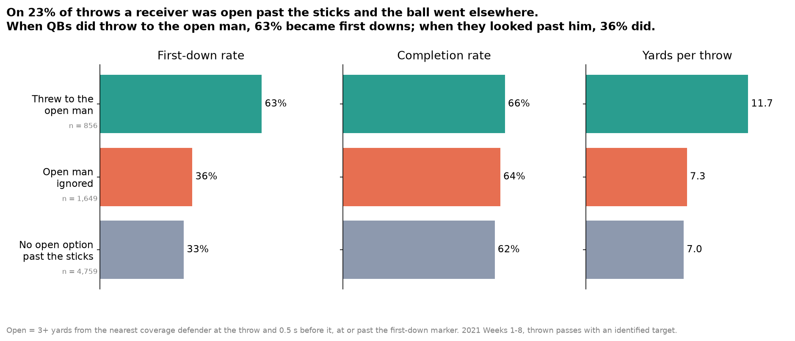
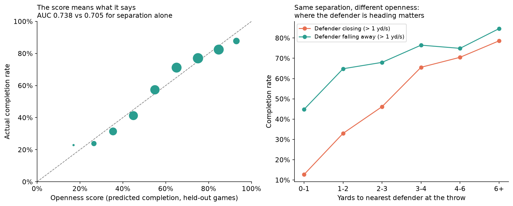
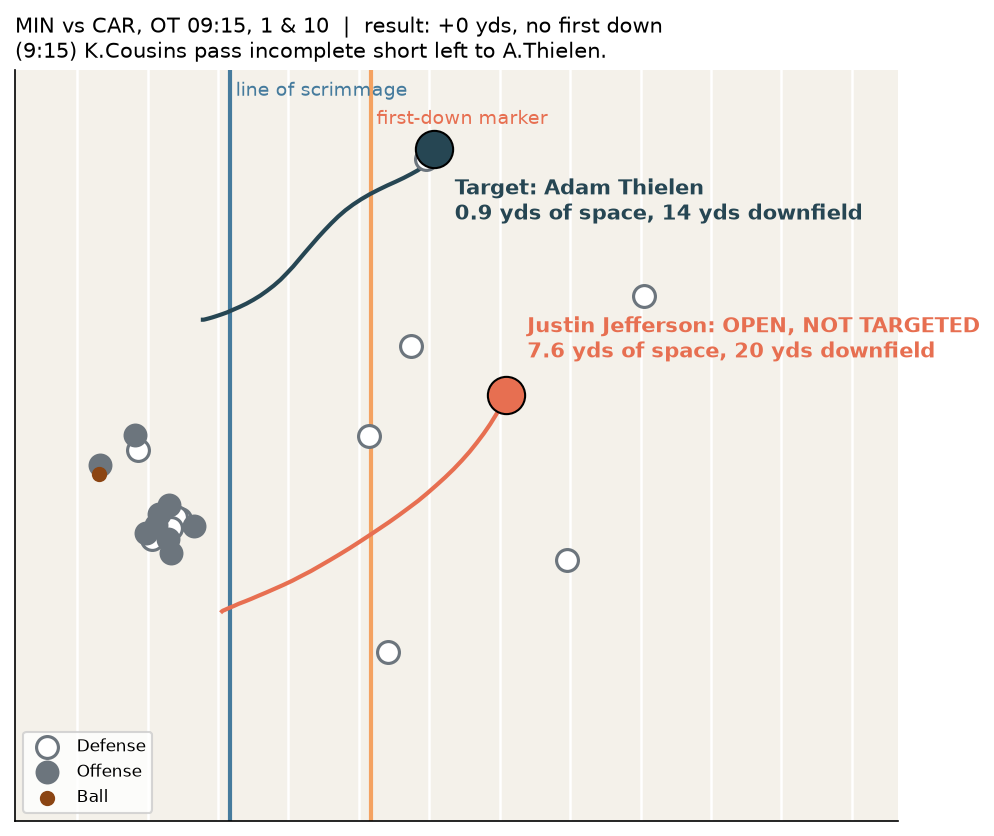

# Open but Ignored



We built **Open but Ignored**, a tracking-data tool that turns each WR, TE and RB's separation from the nearest defender into a 0–100 **openness score** and flags every throw where a receiver was open past the first-down marker but the ball went elsewhere. On 23% of 2021 Weeks 1–8 throws (1,649 of 7,264) an open receiver past the sticks was ignored; those throws gained a first down 36% of the time, compared with 63% when the QB hit the open man, while completion rates barely differed (64% vs 66%), so the cost is first downs, not incompletions. The receivers left open most often were Marquise Brown (33 of 52 open routes), Jaylen Waddle and Justin Jefferson (29 each), and QBs found the open man on 34% of these chances, from Davis Mills (44%) down to Ben Roethlisberger (16%). Method: separation is measured at the throw and 0.5 s before it (tracking ends 0.5 s after the throw), the intended receiver is parsed from the play description, and the openness score is a logistic model on separation, the defender's closing speed, depth, position and coverage (AUC 0.738 on held-out games vs 0.705 for separation alone). Limits: the nearest defender is not always the assigned one, especially in zone; the first-down gap is a comparison, not proof of cause, since ignored throws went shorter (median 4.7 yds downfield); and eight weeks gives 40–100 chances per QB. Coaches can use it in film review to find the open man their QB missed, and broadcasters can use it to show where the first down was.

## Key results

**The gap doesn't depend on how "open" is defined.** Throwing to the open man beats ignoring him by 25–33 points of first-down rate with "open" set at 2, 3, 4 or 5 yards, with or without the 0.5 s check, and in man and zone coverage separately (`outputs/sensitivity.csv`).

**Distance alone is not openness.** At 1–2 yards of separation, throws are completed 65% of the time when the defender is moving away from the receiver and 33% when he is closing. The openness score accounts for this, and its predicted completion rates match actual rates on held-out games.



**Example.** Kirk Cousins throws incomplete to a covered Adam Thielen (0.9 yds of space) while Justin Jefferson is 7.6 yds clear, 20 yds downfield.



## Outputs

| File | What it shows |
|---|---|
| `outputs/1_cost.png` | First-down rate, completion rate and yards when the QB throws to the open man, ignores him, or has no open option |
| `outputs/2_receivers.png` | Receivers most often open past the sticks and not targeted |
| `outputs/3_qbs.png` | How often each QB throws to the open man when one exists |
| `outputs/4_play.png` | The Cousins–Jefferson example play |
| `outputs/5_openness_model.png` | Openness score calibration, and how closing speed changes completion at the same separation |
| `outputs/6_openness_receivers.png` | Most open receivers on routes past the first-down marker |
| `outputs/*.csv` | Full receiver, QB and openness tables, the outcome summary, model scores and the sensitivity check |
| `eda.ipynb` | Exploratory analysis explaining why we chose this metric and which ideas we dropped |

## How to run

```bash
python3 -m venv .venv
.venv/bin/pip install pandas numpy matplotlib seaborn scikit-learn jupyter
.venv/bin/python -m src.run            # about 20 s the first time; caches a tracking summary in cache/
.venv/bin/python -m src.run --refresh  # rebuild the cache
```

| Code | Does |
|---|---|
| `src/data.py` | Loads the data, identifies the intended receiver, measures every route at the throw |
| `src/metric.py` | Defines "open past the sticks", builds the play, receiver and QB tables, runs the sensitivity check |
| `src/openness.py` | Fits and cross-validates the openness score |
| `src/plots.py` | Draws the charts |
| `src/run.py` | Runs everything and checks the results with assertions |

The data dictionary for the competition files is in [`data/README.md`](data/README.md).
