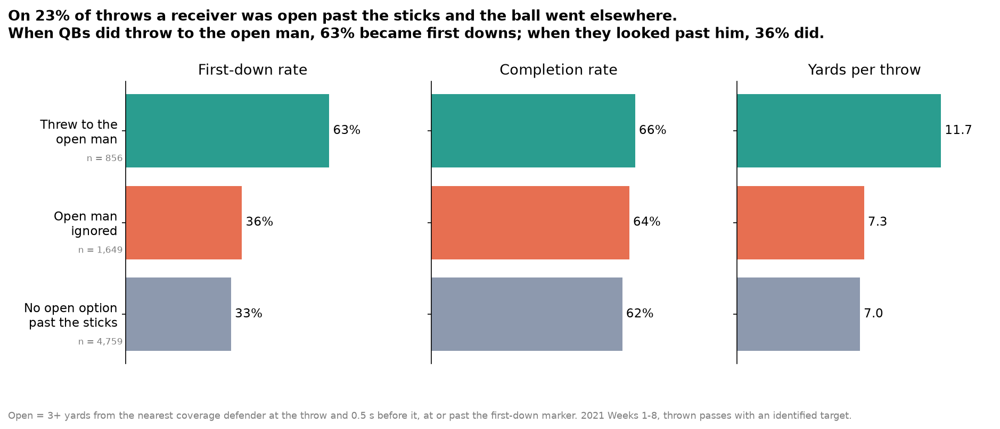

# Open but Ignored



**What we built.** Open but Ignored is a tracking-data metric that flags every receiver who was open past the first-down marker when the ball went to someone else, and grades both the receivers who get left open and the QBs who leave them. **Finding:** on 23% of 2021 Weeks 1–8 throws (1,649 of 7,264), a receiver was 3+ yards from the nearest defender, both at the throw and 0.5 s before it, at or past the sticks, and the QB threw to a covered or short receiver instead. Those throws gained first downs 36% of the time, compared with 63% when QBs did hit the open man, while completion rates were nearly identical (64% vs 66%). Marquise Brown (33 of 52 open routes ignored), Jaylen Waddle and Justin Jefferson (29 each) lost the most chances, and QBs found the open man on 34% of these plays, from Davis Mills (44%) down to Ben Roethlisberger (16%). **Method, assumptions and limits:** the intended receiver is parsed from the play description (99.7% of named receivers matched), separation is measured to the nearest PFF coverage defender, which is not the same as the assigned defender (especially in zone), the comparison shows a link, not proof of cause (ignored plays went to receivers a median 4.7 yds downfield), and QB samples are 40–100 opportunities each. A coach can use it in film review to find the open man the QB missed, and a broadcaster can use it to show where the first down was.

## Does it depend on how "open" is defined?

The first-down gap stays between 25 and 33 points under every definition we tried (`outputs/sensitivity.csv`):

| Definition of "open" | Plays with an open man ignored | First downs, threw to open man | First downs, open man ignored | Gap |
|---|---|---|---|---|
| 2+ yds, also 0.5 s before | 32% | 59% | 34% | 25 pts |
| **3+ yds, also 0.5 s before (used)** | **23%** | **63%** | **36%** | **27 pts** |
| 4+ yds, also 0.5 s before | 14% | 67% | 38% | 29 pts |
| 5+ yds, also 0.5 s before | 7% | 67% | 38% | 29 pts |
| 3+ yds at the throw only | 27% | 64% | 34% | 30 pts |
| 3+ yds, man coverage only | 9% | 70% | 37% | 33 pts |
| 3+ yds, zone coverage only | 29% | 62% | 37% | 25 pts |

## Outputs

| File | What it shows |
|---|---|
| `outputs/1_cost.png` | First-down rate, completion rate and yards when the QB throws to the open man, ignores him, or has no open option |
| `outputs/2_receivers.png` | Receivers most often open past the sticks and not targeted (100+ routes) |
| `outputs/3_qbs.png` | How often each QB throws to the open man when one exists (100+ throws) |
| `outputs/4_play.png` | One play: Kirk Cousins throws incomplete to a covered Adam Thielen while Justin Jefferson is 7.6 yds clear, 20 yds downfield |
| `outputs/receivers.csv`, `outputs/qbs.csv` | Full player tables |
| `outputs/situations.csv`, `outputs/sensitivity.csv` | Headline comparison and the robustness check above |

## How to run

```bash
python3 -m venv .venv && .venv/bin/pip install pandas numpy matplotlib
.venv/bin/python -m src.run            # about 15 s the first time; caches tracking summary in cache/
.venv/bin/python -m src.run --refresh  # rebuild the cache
```

`src/data.py` loads the data, matches targets and measures every route at the throw. `src/metric.py` defines "open" and builds the tables. `src/plots.py` draws the charts. `src/run.py` runs everything and checks the results with assertions. `eda.ipynb` is the exploratory analysis that led here.
